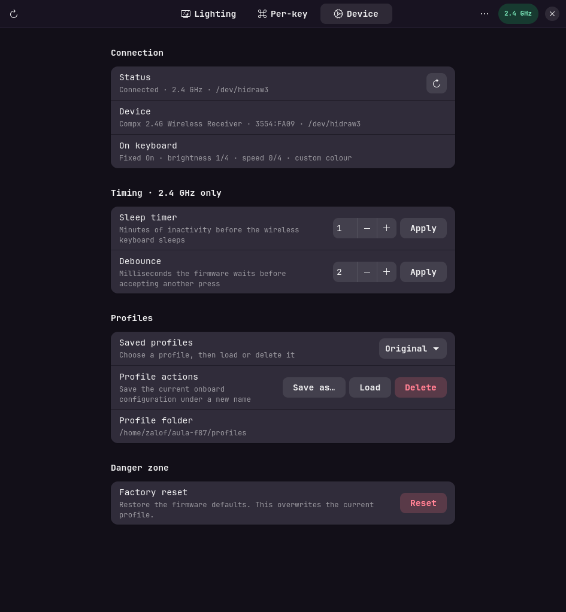

# aula-f87

Persistent onboard RGB control for the **AULA F87 Pro** on Linux, including the
**2.4 GHz wireless receiver** (`3554:FA09`).  Unlike OpenRGB's direct mode, this
tool writes the effect, palette, and per-key data into the keyboard and sends
the save command, so the lighting stays active after the program exits and
works without a host-side RGB daemon.

The protocol was ported from the reverse-engineered 20-byte wireless protocol
used by [F87 Studio for macOS](https://github.com/kmohammedsu/F87-Studio-macOS).
The CLI uses only the standard library and talks directly to `/dev/hidraw`; an
optional GTK4/libadwaita frontend is included for visual editing.

## What works

- Read the current onboard effect, brightness, speed, colour mode, sleep timer,
  and debounce setting.
- Write hardware effects with a custom colour or the effect's spectrum mode.
- Write persistent per-key colours (including a base colour plus overrides).
- Turn the lighting off.
- A native GTK4/libadwaita frontend with an animated keyboard preview, effect
  controls, click-and-drag per-key painting, device settings, named profiles,
  and factory reset.
- Set the wireless sleep timer and debounce time.
- Back up and restore the 10 configuration frames from the CLI.
- Restore factory defaults.
- Detect the 2.4 GHz receiver by its HID report descriptor instead of assuming a
  fixed `/dev/hidrawN` number.
- Experimental wired `258A:010C` support using the 520-byte feature-report
  protocol.  The wired path has not been hardware-tested here.

## Install the udev rule

The existing system rule for this keyboard is already installed as
`/etc/udev/rules.d/60-aula-f87.rules`.  To install it from this repository:

```bash
sudo install -Dm644 udev/60-aula-f87.rules /etc/udev/rules.d/60-aula-f87.rules
sudo udevadm control --reload-rules
sudo udevadm trigger --subsystem-match=hidraw
```

The rule **must be numbered before** `73-seat-late.rules`; otherwise
`TAG+="uaccess"` adds the tag after systemd has already decided whether to
apply the ACL.  Reconnect the receiver after installing the rule if the ACL is
not present.  Check with:

```bash
getfacl /dev/hidraw3
```

## Usage

Run from this directory:

```bash
cd ~/aula-f87
```

Optionally put the launchers on `PATH`:

```bash
ln -sfn "$PWD/aula-f87" ~/.local/bin/aula-f87
ln -sfn "$PWD/aula-f87-gui" ~/.local/bin/aula-f87-gui
```

Then:

```bash
aula-f87 scan                     # list HID interfaces
aula-f87 status                   # read what is currently on the keyboard
aula-f87 effects                  # list effect ids and supported modes

aula-f87 static '#8a5cf6' --brightness 3
aula-f87 effect breathing --color '#8a5cf6' --brightness 3 --speed 2
aula-f87 effect windmill
aula-f87 effect ripple --spectrum --speed 2
aula-f87 off
```

`effect` requires `--color` or `--spectrum` for effects that support colour.
Effects that do not support a custom colour (Rainbow, Windmill, Waterfall,
Blossoming) use their built-in spectrum colours automatically.

Write a per-key layout:

```bash
./aula-f87 per-key \
  --base '#050208' \
  --set esc='#8a5cf6' \
  --set space='#8a5cf6' \
  --set w='#c4a7ff' \
  --set a='#c4a7ff'
```

Or load a JSON object.  Keys can be labels, aliases, or raw LED positions
(`led35`/`#35`); values can be `#RRGGBB`, a named colour, or `[r, g, b]`:

```json
{
  "esc": "#8a5cf6",
  "w": [196, 167, 255],
  "led35": "ff0000"
}
```

```bash
./aula-f87 per-key --file colors.json
```

Back up and restore:

```bash
./aula-f87 backup ~/f87-backup.json
./aula-f87 restore ~/f87-backup.json
./aula-f87 reset --yes             # factory defaults
```

The pre-change configuration from the first test session is saved at
`backups/f87-original-2026-10-26.json` and is also available to the frontend as
`profiles/original.json`.

Timing settings (2.4 GHz only):

```bash
./aula-f87 sleep 10
./aula-f87 debounce 3
```

Other options:

- `-d /dev/hidrawN` or `--device /dev/hidrawN` chooses the control interface.
- `-n` / `--dry-run` reads the keyboard and validates the request without
  writing anything.
- `-v` / `--verbose` prints every 20-byte control packet and its echo.
- `--json` gives machine-readable output for scripting.

## Frontend

A native GTK4/libadwaita window is included.  It is a thin layer over the same
device code as the CLI, so every action uses the onboard write/save/read-back
path.



### Requirements

The CLI has no third-party dependencies.  The frontend additionally needs
PyGObject, GTK 4.10+, libadwaita 1.5+, and pycairo.  Install the distro packages
for those libraries, for example on Arch Linux:

```bash
sudo pacman -S python-gobject gtk4 libadwaita python-cairo
```

or on Debian/Ubuntu:

```bash
sudo apt install python3-gi gir1.2-gtk-4.0 gir1.2-adw-1 python3-cairo
```

The `gui` extra declares the Python packages for pip (`pip install .[gui]`); the
distro packages above also provide the GTK and libadwaita typelibs and are
usually easier on Linux.

### Launch

```bash
./aula-f87 gui
# or
./aula-f87-gui
```

The optional menu launcher can be installed with:

```bash
ln -sfn "$PWD/aula-f87-gui" ~/.local/bin/aula-f87-gui
install -Dm644 aula-f87.desktop ~/.local/share/applications/aula-f87.desktop
```

The included `.desktop` file uses `Exec=aula-f87-gui`, matching the command on
`PATH` or the packaged installation.

### What the window does

- **Lighting** — choose a hardware effect, brightness, speed, spectrum or
  custom colour, preview it on an animated 88-key layout, and save it.
- **Per-key** — pick a colour, click or drag across keycaps, right-click to
  erase, fill or clear the layout, and save it as custom mode.
- **Device** — read the current effect and timing, set the wireless sleep timer
  and debounce, switch named profiles, and reset to factory defaults.

HID operations run on worker threads, so the preview keeps animating while a
write is in progress.  The window refuses new operations until the previous one
finishes.

### Frontend notes

- The same udev rule is required.  The frontend does not use `pkexec`; it opens
  the existing `/dev/hidraw` device with the user's ACL.
- If the wireless keyboard has gone to sleep while the receiver stayed
  connected, press a key to wake the keyboard and click the refresh button in
  the header.  The sleep timer can be changed on the Device page.
- Use **Save as…** on the Device page to name the current onboard
  configuration, choose it in the drop-down, then click **Load**.  **Delete**
  removes the local profile file only.
- Profiles go to `~/aula-f87/profiles/NAME.json` by default.  Set
  `AULA_F87_PROFILE_DIR` to use a different directory.  These are the same
  JSON frames used by the CLI `backup` and `restore` commands.
- Per-key colours and the palette are write-only on this keyboard.  The
  painting canvas therefore starts empty, and the preview uses the pending
  target colour rather than attempting to read the stored colour back.
- Loading a profile restores the configuration frames, but not the palette or
  per-key data; re-apply a custom colour or per-key layout after loading if
  needed.  (The same limitation applies to the CLI.)

### AUR

Packaging files are in `aur/aula-f87/`.  The package installs the `aula-f87`
and `aula-f87-gui` commands, the desktop entry, and the udev rule.  Update the
GitHub URL in `PKGBUILD` and run `updpkgsums` if your repository or tag
differs, then:

```bash
cd aur/aula-f87
makepkg -si
```

## Why this persists

The wireless protocol uses 20-byte reports with report id `0x13`:

1. read request: command `0x44`, subcommand `0x01`
2. configuration write: command `0x04`, subcommand `0x0A`, 10 frames
3. palette write: command `0x09`, subcommand `0x25`, 37 frames
4. per-key write: command `0x02`, subcommand `0x1C`, 28 frames
5. save: command `0x0A`, subcommand `0x01`

The save frame is what makes the change survive unplugging, power-cycling, and
using the keyboard wirelessly.  Every write is echoed by the receiver and is
followed by a configuration read-back.  The tool refuses to continue if a
packet is not echoed and reports a verification error if the keyboard does not
retain the requested effect or parameters.

## Notes and limitations

- The separate palette is not readable by the known protocol.  A profile stores
  the 10 configuration frames but not the RGB palette.  Restoring an effect
  that uses a custom colour therefore requires re-applying that colour with
  `static` or `effect --color`.
- Frame 9 contains firmware-managed trailer state in addition to the
  `0x5A 0xA5` marker and is not compared byte-for-byte during restore.
- Applying an effect uses the official write path, which sets a byte in frame 0
  to `0x01`; this is displayed as a 2 ms debounce.  Run `./aula-f87 debounce 3`
  if a different debounce value is desired.
- Wired `258A:010C` support is implemented but untested because the wired
  interface was not available during development.  The wired protocol has no
  separate save command; it writes a 520-byte feature report directly.
- OpenRGB is not required.  This tool is intentionally a one-shot onboard
  writer rather than a streaming/direct-mode controller.
